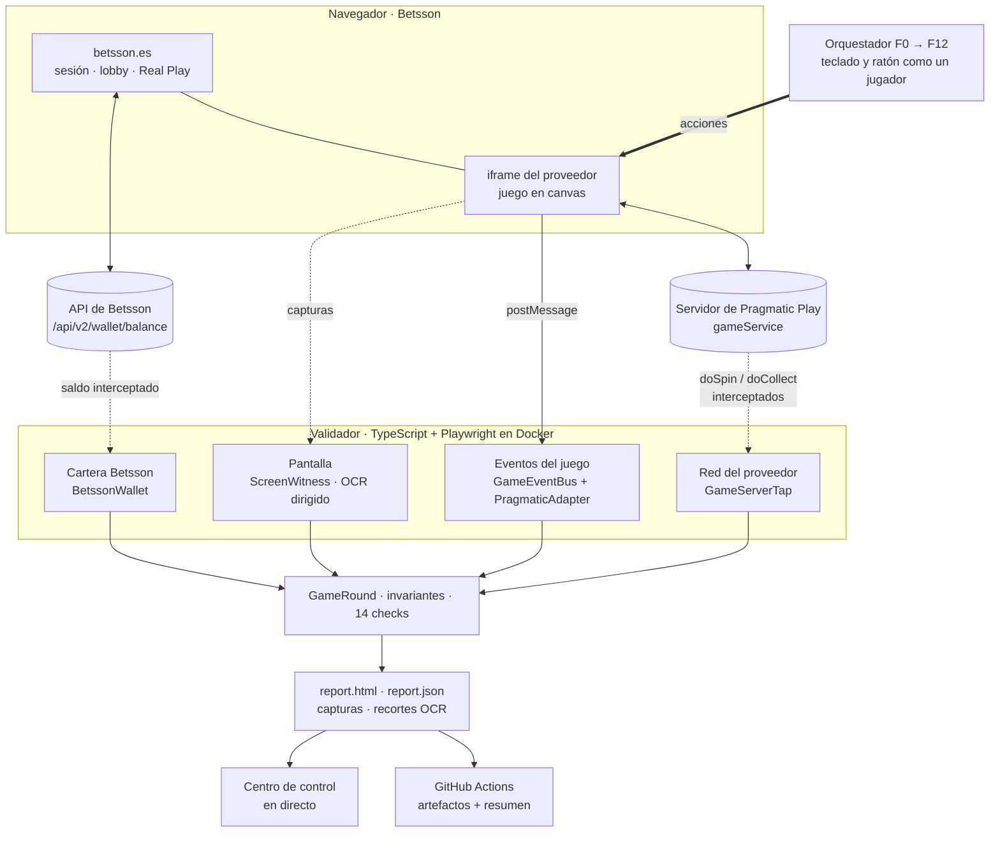
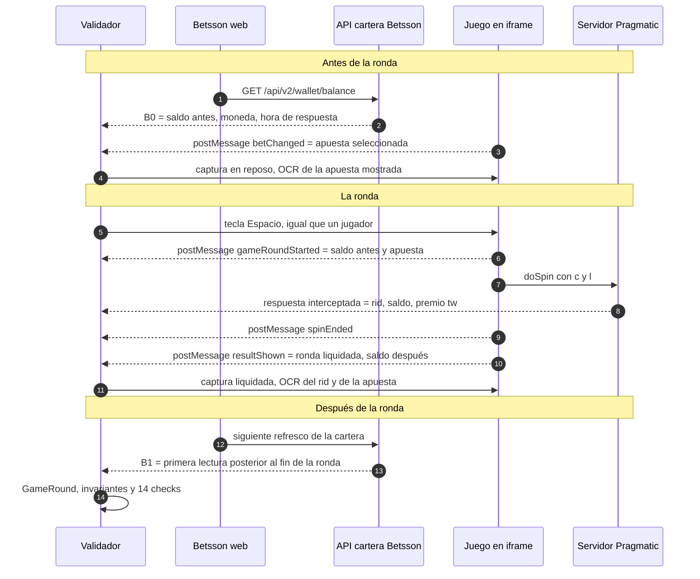
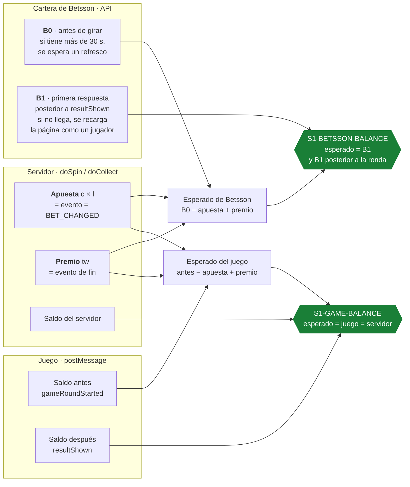
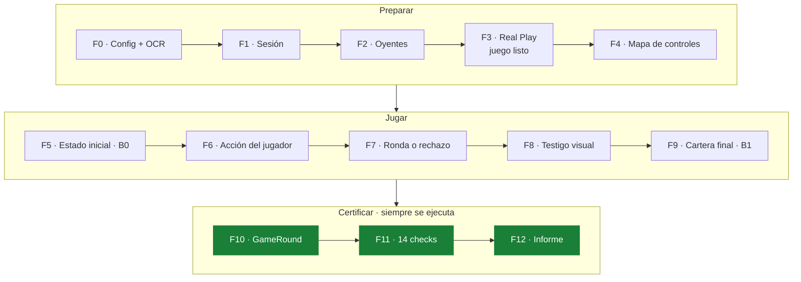

# Intelligent Game Validation · Betsson × Pragmatic Play

**Validador autónomo que juega como un jugador real y certifica, con evidencias, que un juego de terceros funciona dentro de Betsson.**


Los juegos de proveedores externos se ejecutan en un **canvas dentro de un iframe de otro dominio**: no hay DOM que inspeccionar. Las pruebas clásicas no ven nada. Nuestro validador entra en Betsson, abre el juego en **Real Play**, gira como lo haría una persona y **cruza cuatro fuentes independientes**: lo que el juego anuncia, lo que decide el servidor, lo que cobra la cartera de Betsson y lo que ve el jugador en pantalla. Cada comprobación termina en **PASS o FAIL**, con el dato esperado, el dato observado, de dónde sale y la captura que lo demuestra.

> **Para Betsson:** cada nuevo juego o versión de un proveedor se puede certificar en segundos, sin acceso al código del juego ni acuerdos de integración, y con un informe que cualquier persona de QA, producto o cumplimiento puede auditar.

---

## En cifras

| | |
|---|---|
| **14 checks** en 2 escenarios | Tirada completada (8) y saldo insuficiente (6), con IDs estables `S1-*` / `S2-*` |
| **4 fuentes cruzadas** | Eventos del juego · red del proveedor · cartera de Betsson · pantalla (OCR) |
| **~12 s por ronda** | De pulsar «Lanzar» al informe en el centro de control (medido sobre la maqueta) |
| **Fallos provocados detectados** | Cartera que no abona, moneda equivocada, aviso en otro idioma: cada uno cae exactamente en su check |
| **0 credenciales en evidencias** | Máscaras, revisión OCR de cada captura y escáner de secretos antes de publicar |

📄 **Informe de entrega con resultados y evidencias:** [tester/informe/INFORME.md](tester/informe/INFORME.md)

---

## Pruébalo en 1 minuto: centro de control

**<http://localhost:8095>**: lanzas una ronda y ves al validador trabajar en directo.

```bash
bash arranque.sh --landing                                          # primera vez (macOS / Linux)
powershell -ExecutionPolicy Bypass -File .\arranque.ps1 -Landing    # primera vez (Windows)
docker compose -f tester/compose.yaml up -d control                 # las siguientes veces
```

- **▶ Lanzar demo en directo:** el navegador del validador retransmitido, las fases F0-F12 con su tiempo, los eventos, la red, la cartera, los recortes del OCR y cada check pasando a ✅ o ❌.
- **Fallos provocados:** un botón por fallo. El validador lo caza en el check que toca.
- **Historial y agilidad:** tiempo por fase de cada ejecución y enlace a su informe.

El centro de control trabaja contra una **maqueta local de Betsson + Pragmatic Play** (`tester/mock/`) que reproduce el comportamiento observado en la web real, y el validador corre en **modo real**: exactamente el mismo código que contra betsson.es. Solo hacen falta Git y Docker ([ARRANQUE.md](ARRANQUE.md)).

---

## Arquitectura



**Principio de diseño:** el validador **solo observa lo que la página ya recibe** y actúa con teclado y ratón como una persona. No inyecta código en el juego, no llama a APIs privadas y no fuerza nada. La red sirve para contrastar; lo que el jugador ve en pantalla es la prueba final.

---

## De dónde sale cada dato



| Dato | Fuente | Cómo se obtiene | Módulo |
|---|---|---|---|
| Inicio y fin de la ronda | Eventos del juego | `postMessage` del iframe a Betsson: `gameRoundStarted`, `spinEnded`, `resultShown`, traducidos a eventos estándar (`ROUND_STARTED`, `SPIN_ENDED`, `ROUND_ENDED`) | `providers/PragmaticAdapter.ts`, `game/GameEventBus.ts` |
| Apuesta usada | Eventos + red | Evento de inicio de ronda y petición `doSpin` (`c × l`), contrastados con el último `betChanged` | `game/GameServerTap.ts` |
| Id de ronda (`rid`) | Red + pantalla | Respuesta de `doSpin` y lectura OCR del `#rid` en la barra inferior del juego | `game/GameServerTap.ts`, `vision/ScreenWitness.ts` |
| Premio | Eventos + red | `tw` de la respuesta de `doSpin` y datos de fin de ronda | `game/GameServerTap.ts` |
| Saldo del juego | Eventos + red | Saldo antes y después que anuncia el juego; saldo de `doSpin`/`doCollect` | `domain/GameRound.ts` |
| Saldo de Betsson | Cartera | Respuestas de `/api/v2/wallet/balance` que pide la propia web, con la hora de respuesta | `site/BetssonWallet.ts` |
| Apuesta mostrada, `#rid`, aviso de saldo | Pantalla | OCR dirigido a zonas localizadas por sus anclas («APUESTA», «#»), con consenso de dos lecturas | `vision/RoiLocator.ts`, `vision/ScreenWitness.ts` |
| Moneda | Las tres | Moneda del juego, de la cartera y símbolo en pantalla; deben coincidir con la del mercado | `validation/rules.ts` |

---

## Trazabilidad del saldo

El saldo es el dato más sensible del reto, así que no se fía de una sola fuente: **se reconstruye la ronda entera y se comprueba la misma fórmula en dos sitios independientes**.



Cómo se garantiza que el saldo comparado es el correcto:

- **Cada lectura lleva su hora.** La cartera se registra con la hora de *respuesta*, y B1 solo vale si es **posterior** al fin de la ronda (`resultShown`). Una lectura anterior se marca como tal y el check da FAIL: nunca se compara un saldo viejo.
- **Orden temporal comprobado.** El validador exige `acción < inicio < doSpin < fin < captura < B1`. Si el orden se rompe, queda como hallazgo en el informe.
- **Céntimos enteros.** Todos los importes se convierten a céntimos al leerlos: sin errores de coma flotante en `99,00 − 1,00 + 2,00`.
- **Tres fuentes para la apuesta y el premio.** La apuesta del evento tiene que coincidir con `c × l` de `doSpin` y con el último `betChanged`; si se contradicen, `S1-BET-USED` falla antes de usarla en la fórmula.
- **Escenario 2.** B1 se toma tras el intento y tras al menos un refresco completo de la cartera; además, ningún evento de saldo del juego puede cambiar (`S2-GAME-UNCHANGED`) ni puede haber un `doSpin` cobrado.
- **Prueba visual.** Cada informe incluye la captura de Betsson tras la ronda (B1) y la pantalla liquidada con el saldo y el premio.

Ejemplo real del informe (maqueta, ronda con premio):

| Check | Esperado | Observado | Resultado |
|---|---|---|---|
| `S1-GAME-BALANCE` | 100,00 € = 99,00 € − 1,00 € + 2,00 € | evento 100,00 € · red 100,00 € | ✅ PASS |
| `S1-BETSSON-BALANCE` | 100,00 € = 99,00 € − 1,00 € + 2,00 € | 100,00 € | ✅ PASS |
| `S1-BETSSON-BALANCE` con la cartera saboteada (no abona el premio) | 101,00 € = 100,00 € − 1,00 € + 2,00 € | 99,00 € | ❌ FAIL |

Con la cartera saboteada, el juego y el servidor siguen cuadrando (`S1-GAME-BALANCE` ✅): el validador señala **exactamente** que el fallo está en el abono de Betsson, no en el juego.

---

## Las comprobaciones

| Escenario | Check | Qué demuestra | Fuentes |
|---|---|---|---|
| 1 · Tirada completada | `S1-ROUND-STARTED` | La tirada empezó por la acción del jugador | eventos |
| | `S1-ROUND-ENDED` | La ronda terminó y el resultado se mostró | eventos |
| | `S1-BET-USED` | La apuesta es coherente en todas las fuentes y ≤ máximo configurado | eventos, red |
| | `S1-BET-VISIBLE` | La apuesta que ve el jugador es la que se cobró | pantalla, eventos, red |
| | `S1-CURRENCY` | Moneda correcta del mercado | eventos, cartera, pantalla |
| | `S1-GAME-BALANCE` | Saldo del juego: antes − apuesta + premio | eventos, red |
| | `S1-BETSSON-BALANCE` | Saldo de Betsson: B0 − apuesta + premio = B1 | cartera |
| | `S1-RID-VISIBLE` | La ronda que vio el jugador es la que procesó el servidor | pantalla, red |
| 2 · Saldo insuficiente | `S2-REJECTED` | La tirada se rechazó: ningún inicio ni `doSpin` cobrado | eventos, red |
| | `S2-MSG-LANG-VISIBLE` | El aviso aparece y está en el idioma del mercado | pantalla |
| | `S2-BET-VISIBLE` | Apuesta mostrada | pantalla, eventos |
| | `S2-CURRENCY` | Moneda correcta | eventos, cartera, pantalla |
| | `S2-BETSSON-UNCHANGED` | La cartera no cambió | cartera |
| | `S2-GAME-UNCHANGED` | El saldo del juego no cambió | eventos |

**Verificado con fallos provocados** (centro de control, 15/10):

| Escenario | Fallo provocado | Resultado | Check que lo caza |
|---|---|---|---|
| Tirada completada | ninguno | ✅ 8/8 | — |
| Tirada completada | la cartera no abona el premio | ❌ 7/8 | `S1-BETSSON-BALANCE` |
| Tirada completada | moneda equivocada | ❌ 7/8 | `S1-CURRENCY` |
| Saldo insuficiente | ninguno | ✅ 6/6 | — |
| Saldo insuficiente | aviso en inglés en el mercado español | ❌ 5/6 | `S2-MSG-LANG-VISIBLE` |

---

## Ciclo de una ejecución



Si una fase falla, las siguientes quedan como «no ejecutada» con el motivo, y **F10-F12 se ejecutan siempre**: nunca hay una ejecución sin informe que explique dónde y por qué se paró.

---

## Lo que lo hace fiable

- **Ve como un jugador.** El rid, la apuesta y el aviso se leen en pantalla con OCR dirigido a zonas concretas, localizadas por sus anclas («APUESTA», «#»), no por coordenadas fijas: funciona con otras resoluciones y versiones del juego.
- **Consenso en el OCR.** Un valor solo se acepta si **dos lecturas con preprocesados distintos coinciden**. Si no, el resultado es «no legible» con su motivo: el validador nunca se inventa un número.
- **Agnóstico del proveedor.** Los eventos de Pragmatic se traducen a eventos estándar en un adaptador (`ProviderAdapter`); añadir otro proveedor es añadir un adaptador.
- **Contratos tipados.** Configuración, lecturas, checks e informe están validados con esquemas `zod` (C1-C18): un informe que no cumple el contrato no se da por bueno.
- **Prudente con dinero real.** Apuesta máxima configurable, una sola tirada por escenario, sin reintentos a ciegas y ejecuciones en cola en CI (una cuenta = un saldo).

## Seguridad y privacidad

| Riesgo | Medida |
|---|---|
| Credenciales en trazas o capturas | Login fuera de las pruebas, en un navegador sin traza; credenciales solo en `.env` local y en los secrets de GitHub |
| Datos de la cuenta en capturas | Máscaras por selector y revisión OCR de cada captura: si aparece el usuario, se difumina antes del informe |
| Tokens de sesión en logs | Censura de consola, línea de tiempo e informe; escáner de secretos que bloquea la publicación |
| Publicar resultados reales | Las ejecuciones reales no van a GitHub Pages salvo activación expresa |
| Cadena de suministro | Actions fijadas por SHA, dependencias exactas (`npm ci`), imagen oficial de Playwright |

## Integración continua

El workflow [`Validate games`](.github/workflows/validate.yml) ejecuta los tests unitarios y los dos escenarios en una matriz **escenario × mercado**, sube el informe y las evidencias como artefactos, publica el resumen PASS/FAIL en la propia ejecución y genera una página con la matriz de checks. Se lanza a mano (simulado o real) o en cada push a `main`.

---

## Ejecutar

Todo en Docker: en el ordenador solo hacen falta Git y Docker. Guía paso a paso: [ARRANQUE.md](ARRANQUE.md).

| Para qué | Comando |
|---|---|
| Instalar y probarlo todo | `bash arranque.sh` (Windows: `.\arranque.ps1`) |
| Centro de control | `docker compose -f tester/compose.yaml up -d control` → <http://localhost:8095> |
| Tests unitarios | `docker compose -f tester/compose.yaml run --rm tester npm run unit` |
| Los dos escenarios en simulado | `docker compose -f tester/compose.yaml run --rm -e RUN_MODE=simulated tester npx playwright test --project=es` |
| Escenario 1 contra betsson.es (cuenta de prueba en `tester/.env`) | `bash arranque.sh --real` |
| Informe de entrega | `docker compose -f tester/compose.yaml run --rm tester node scripts/make-report.mjs` |

Cada ejecución deja en `tester/reports/<mercado>-<escenario>/` el `report.html` (esperado, observado, fuentes y evidencias de cada check), el `report.json` y las capturas y recortes del OCR.

## Documentación

| Fichero | Contenido |
|---|---|
| [tester/informe/INFORME.md](tester/informe/INFORME.md) | Informe de entrega: PASS/FAIL por check, escenario y mercado, con evidencias |
| [ARRANQUE.md](ARRANQUE.md) | Instalar y ejecutar desde cero, centro de control y problemas habituales |
| [tester/README.md](tester/README.md) | El validador por dentro: fases, decisiones, centro de control, seguridad |
| [docs/reto.md](docs/reto.md) | Enunciado oficial, comprobaciones y evaluación |
| [docs/diseno.md](docs/diseno.md) | Etapas, módulos, formato de salida y decisiones |
| [docs/web-betsson.md](docs/web-betsson.md) | Lo que sabemos de la web de Betsson |
| [ESTADO.md](ESTADO.md) | Qué funciona y quién lleva cada parte |
| [CONTRIBUTING.md](CONTRIBUTING.md) | Cómo trabajamos en el repo |

> `bot/` contiene el primer esqueleto en Python, anterior al enunciado oficial; el producto está en `tester/`.

---

Proyecto del equipo para el reto **Intelligent Game Validation** de Betsson · Malackathon 2026, ETSII Málaga.
