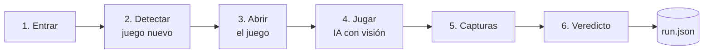

# Diseño del bot

> Es una **propuesta**: la confirmamos o la cambiamos cuando sepamos más de la web (ver [web-betsson.md](web-betsson.md)).

## Idea general

El bot es una cadena de **6 etapas independientes**. Cada una hace su parte, guarda sus capturas y dice si ha ido bien. Esto tiene dos ventajas: cada persona puede trabajar en una etapa sin pisar a las demás y, cuando algo falla, se sabe en qué etapa.

Donde la web tiene HTML usamos automatización normal (Playwright), que es rápida, gratis y fiable. Dentro del juego solo hay un canvas sin elementos que seleccionar, así que ahí usamos un **modelo de IA con visión**: mira la captura y dice dónde hacer clic. También ayuda a dar el veredicto.



| # | Etapa | Cómo | Plan B |
|---|---|---|---|
| 1 | Entrar | Playwright abre la web y cierra las cookies | — |
| 2 | Detectar juego nuevo | Leer la API del lobby y comparar con la vez anterior, o buscar la etiqueta "New" | Leer las tarjetas del HTML |
| 3 | Abrir el juego | Clic en el juego y esperar a que aparezca el canvas | Ir directamente a la URL del juego |
| 4 | Jugar | Captura → la IA dice dónde está el botón de jugar → clic → esperar | Posición fija del botón según el proveedor |
| 5 | Capturas | Una antes y otra después de cada etapa; vídeo opcional | — |
| 6 | Veredicto | Reglas objetivas primero; la IA solo explica o desempata | Solo reglas |

## Cuándo es PASS

Todo esto tiene que cumplirse:

1. El juego carga: se ve el canvas, no está en blanco y no hay pantalla de error.
2. La jugada cambia algo: la captura de después es claramente distinta de la de antes.
3. La ronda termina: el juego vuelve a estar quieto o cambia el saldo.
4. No hay errores graves en la consola ni fallos de servidor.

Si falta algo, es **FAIL**, siempre con el motivo y la etapa donde falló.

## Qué deja cada ejecución

Cada ejecución crea una carpeta `runs/<run_id>/` (no se sube a git). Las mejores se copian a `evidencias/` para la demo. **Todas las etapas escriben con este formato**: si alguien lo cambia, lo avisa en el PR.

```
runs/20261015T103200Z-a1b2/
├── run.json
├── 01_entrar.png
├── 02_lobby.png
├── 03_juego_cargado.png
├── 04a_antes_jugada.png
└── 04b_despues_jugada.png
```

```json
{
  "run_id": "20261015T103200Z-a1b2",
  "started_at": "2026-10-15T10:32:00Z",
  "finished_at": "2026-10-15T10:33:12Z",
  "url": "https://...",
  "game": { "id": "...", "name": "...", "provider": "...", "why_new": "Tiene la etiqueta New" },
  "steps": [
    { "name": "navigate", "status": "pass", "duration_ms": 2310, "screenshots": ["01_entrar.png"], "notes": "Cookies rechazadas" }
  ],
  "verdict": { "result": "PASS", "failed_step": null, "reason": "Carga, la jugada cambia el canvas y la ronda termina", "decided_by": "rules" },
  "ai_usage": { "calls": 3, "usd": 0.02 }
}
```

Los nombres de los campos van en inglés porque los usa el código, pero los textos que lee una persona (`reason`, `notes`, `why_new`) van en español. `duration_ms` y `ai_usage` están ahí para el pitch: con ellos podemos decir cuánto tarda y cuánto cuesta validar un juego.

## Decisiones tomadas

Se añade una fila cada vez que elegimos entre varias opciones.

| Fecha | Decisión | Por qué | Descartado | Estado |
|---|---|---|---|---|
| 14/10 | Automatización normal donde hay HTML y IA con visión solo dentro del canvas | Fiable y barato donde se puede, flexible donde hace falta | IA que lo hace todo (lenta, cara, arriesgada en directo); solo posiciones fijas (no sirve para juegos nuevos) | Propuesta |
| 14/10 | Python + Playwright dentro de Docker | Lo conocemos y Playwright gestiona bien los iframes y las capturas | — | Propuesta |
