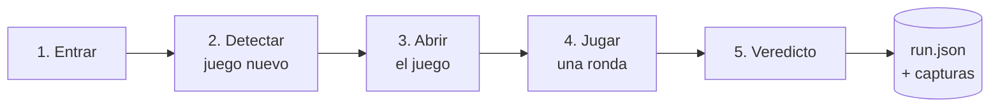

# Diseño del bot

> Es una **propuesta**: se confirma o se cambia cuando sepamos más de la web (ver [web-betsson.md](web-betsson.md)).

## Idea general

El bot es una cadena de **5 etapas independientes**. Cada etapa es un módulo separado, lo lleva una persona, se puede ejecutar sola y guarda sus propias capturas.



| # | Etapa                | Plan A                                                          | Plan B                                                                                           | Se ejecuta sola con…         |
|---|----------------------|-----------------------------------------------------------------|--------------------------------------------------------------------------------------------------|------------------------------|
| 1 | Entrar               | Playwright abre la web y cierra el banner de cookies            | —                                                                                                | la URL                       |
| 2 | Detectar juego nuevo | Señal del propio lobby: etiqueta "New" o categoría de novedades | Comparar la lista de juegos (mejor si sale de la API del lobby) con una foto guardada en el repo | la URL del lobby             |
| 3 | Abrir el juego       | Clic en el juego y esperar a que el canvas esté visible         | Ir directamente a la URL del juego                                                               | la URL o el id de un juego   |
| 4 | Jugar una ronda      | Lanzar el spin con el teclado (muchos juegos usan Espacio)      | IA con visión: localiza el botón en una captura y se hace clic en esas coordenadas               | la URL del juego ya abierto  |
| 5 | Veredicto            | Reglas sobre lo que han registrado las etapas anteriores        | La IA explica el resultado o desempata                                                           | una carpeta `runs/<run_id>/` |

Lo que todavía no está comprobado: que haya modo demo sin login, que Espacio lance el spin y cómo se comunica el juego con su servidor. Eso lo confirmará la exploración de la web.

## Cuándo es PASS

Las tragaperras se animan solas, así que **comparar capturas no demuestra que la jugada haya funcionado**. La prueba fiable está en el tráfico de red:

1. **El juego carga:** el canvas es visible, no hay pantalla de error y las peticiones al proveedor no fallan (sin 4xx ni 5xx).
2. **La jugada llega al servidor:** al lanzar el spin sale una petición (HTTP o WebSocket) hacia el proveedor y vuelve una respuesta válida.
3. **La ronda se resuelve:** la respuesta trae el resultado o el saldo cambia (en la respuesta o en pantalla).
4. **No hay errores graves** en la consola.

Las capturas de antes y después se guardan como **prueba visual**, pero no deciden el veredicto. Si falla cualquier punto, es **FAIL**, con el motivo y la etapa donde falló.

Para la demo conviene enseñar también un **FAIL provocado**: si se bloquea el dominio del proveedor con `page.route`, el juego no carga y el bot tiene que detectarlo.

## Módulos

```
bot/
├── stages/
│   ├── enter.py      # etapa 1
│   ├── detect.py     # etapa 2
│   ├── launch.py     # etapa 3
│   ├── play.py       # etapa 4
│   └── verdict.py    # etapa 5
├── run.py            # orquestador: encadena las etapas    ← compartido
└── evidence.py       # capturas, traza y run.json           ← compartido
```

Cada etapa es de quien la lleva. Los ficheros marcados como **compartido** se cambian en PRs pequeños y aparte, que se fusionan enseguida.

## Qué deja cada ejecución

Cada ejecución crea `runs/<run_id>/`, que no se sube a git. Las mejores se copian a `pitch/evidencias/`.

```
runs/20261015T103200Z-a1b2/
├── run.json
├── trace.zip        # traza de Playwright: cada acción con su captura y su tráfico de red
├── 01_entrar.png
├── 02_lobby.png
├── 03_juego.png
├── 04a_antes.png
└── 04b_despues.png
```

```json
{
  "run_id": "20261015T103200Z-a1b2",
  "started_at": "2026-10-15T10:32:00Z",
  "finished_at": "2026-10-15T10:33:12Z",
  "url": "https://...",
  "game": { "id": "...", "name": "...", "provider": "...", "why_new": "Tiene la etiqueta New" },
  "steps": [
    { "name": "enter", "status": "pass", "duration_ms": 2310, "screenshots": ["01_entrar.png"], "notes": "Cookies rechazadas" }
  ],
  "verdict": {
    "result": "PASS",
    "failed_step": null,
    "reason": "Carga, el spin recibe respuesta del servidor y cambia el saldo",
    "checks": { "loaded": true, "spin_request": true, "round_resolved": true, "console_errors": 0 }
  },
  "ai_usage": { "calls": 0, "usd": 0.0 }
}
```

- `steps[].status` puede ser `pass`, `fail` o `skipped`.
- `verdict.result` puede ser `PASS` o `FAIL`.
- Los textos para personas (`reason`, `notes`, `why_new`) van en español.
- Este formato lo comparten todas las etapas: cambiarlo es un cambio compartido.

Para abrir la traza: `npx playwright show-trace runs/<run_id>/trace.zip`, o arrastrar el fichero a trace.playwright.dev.

## Decisiones tomadas

| Fecha | Decisión                                                                                     | Por qué                                                                     | Descartado                                                                |
|-------|----------------------------------------------------------------------------------------------|-----------------------------------------------------------------------------|---------------------------------------------------------------------------|
| 14/10 | Automatización determinista donde se pueda; IA con visión solo como plan B dentro del canvas | Es fiable, barata y rápida en directo                                       | Un agente de IA que lo haga todo (lento, caro e impredecible en una demo) |
| 14/10 | Veredicto basado en el tráfico de red, con las capturas como prueba visual                   | Las tragaperras se animan solas, así que comparar píxeles daría falsos PASS | Diferencia de píxeles como criterio principal                             |
| 14/10 | Python + Playwright en Docker (propuesta)                                                    | Gestiona bien iframes, red, capturas y trazas                               | —                                                                         |
