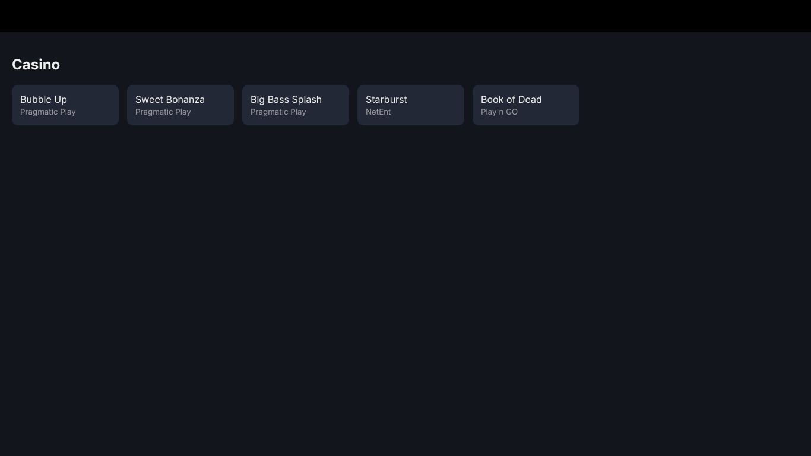
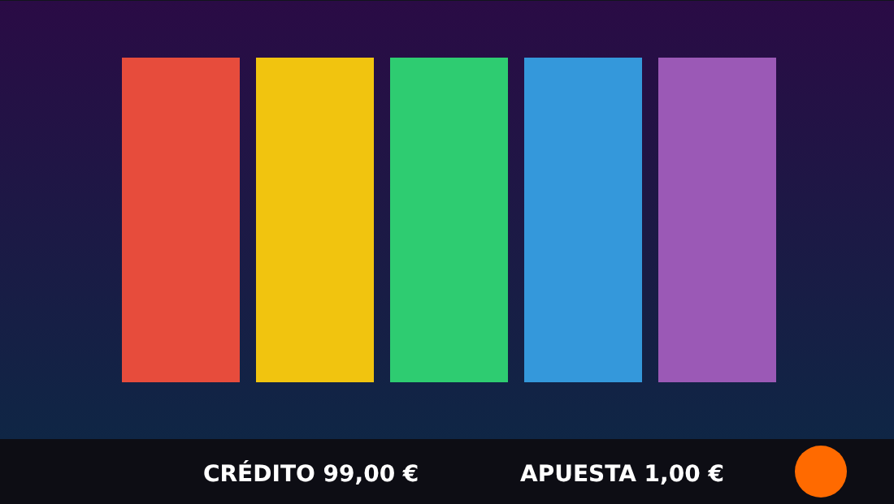
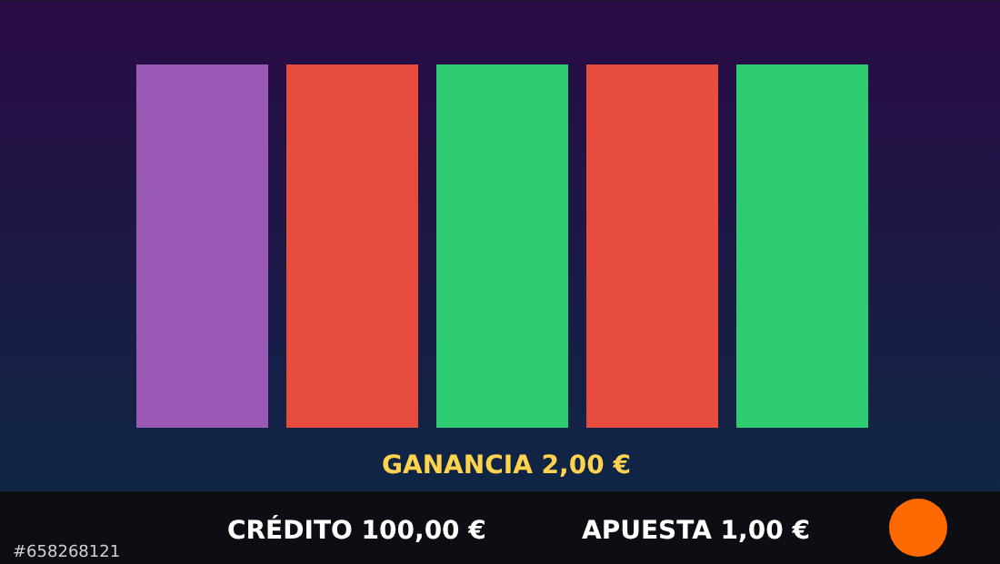
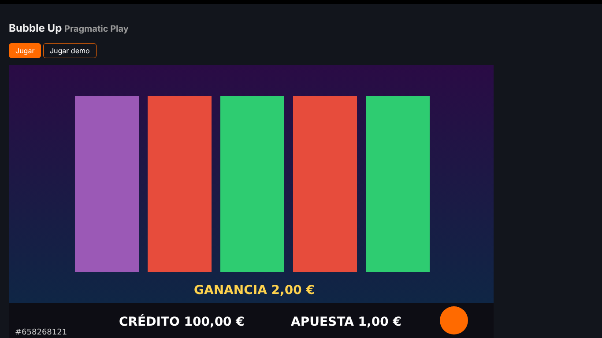
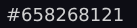
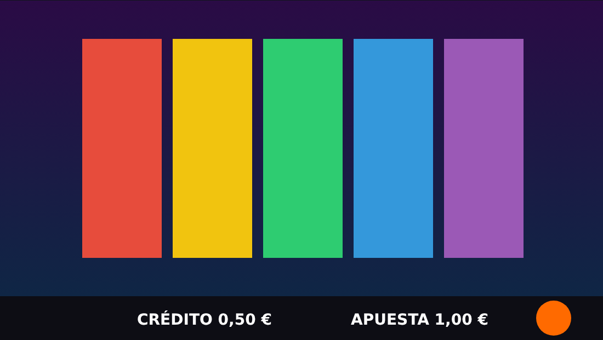
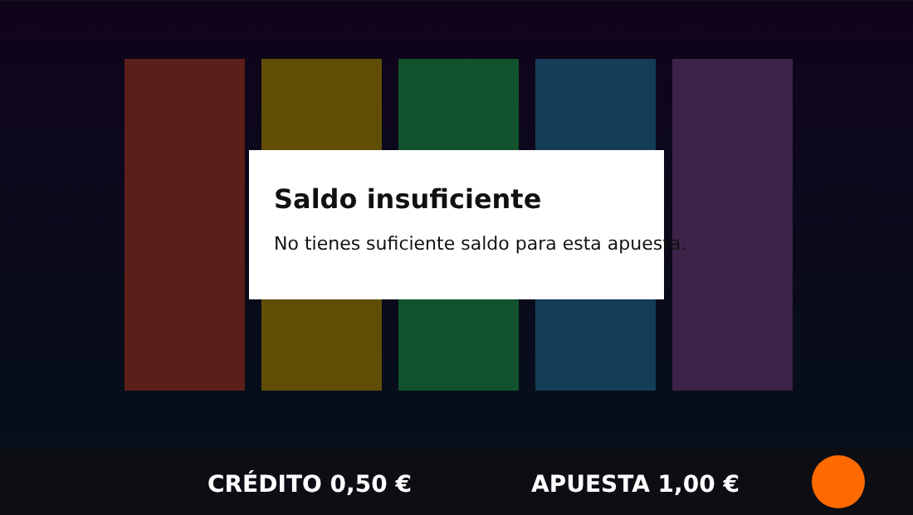
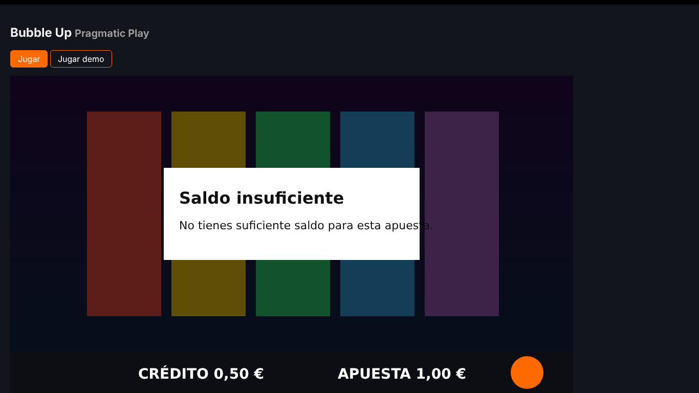
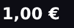
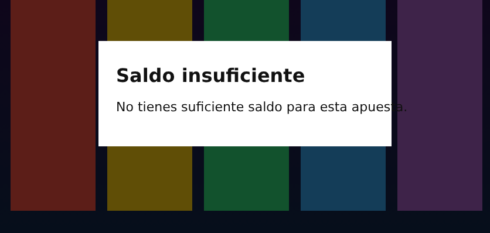

# Informe de validación · Pragmatic Play en Betsson

> **Maqueta local** de Betsson + Pragmatic Play (`tester/mock/`, la del centro de control) con el validador en **modo real**: el mismo código, fases y checks que contra betsson.es (login, Real Play, eventos `postMessage`, `doSpin`/`doCollect`, cartera `/api/v2/wallet/balance`). No es dinero real.

Generado el 2026-10-15T17:33:43.882Z con `tester/scripts/make-report.mjs` a partir de `tester/reports/*/report.json`.

## Resumen

| Escenario | Mercado | Contra qué | Juego | Resultado | Checks | Informe completo |
|---|---|---|---|---|---|---|
| Escenario 1 · Tirada completada | mock | maqueta local | Bubble Up | ✅ PASS | 8/8 | [report.html](mock-completed-spin/report.html) |
| Escenario 2 · Saldo insuficiente | mock | maqueta local | Bubble Up | ✅ PASS | 6/6 | [report.html](mock-insufficient-balance/report.html) |

## Saldo de Betsson

Regla del escenario 1: `saldo después = saldo antes − apuesta + premio`. Escenario 2: el saldo no cambia. Se lee de la cartera de Betsson (su API), no del juego.

| Check | Escenario | Mercado | Resultado | Esperado | Observado |
|---|---|---|---|---|---|
| `S1-BETSSON-BALANCE` | completed-spin | mock | ✅ PASS | 100,00 € = 99,00 € − 1,00 € + 2,00 € | 100,00 € |
| `S2-BETSSON-UNCHANGED` | insufficient-balance | mock | ✅ PASS | 0,50 € (sin cambios) | 0,50 € |

## Todos los checks

| Check | Qué comprueba | Escenario | Mercado | Resultado | Esperado | Observado | Fuentes | Evidencia |
|---|---|---|---|---|---|---|---|---|
| `S1-ROUND-STARTED` | La tirada empezó | completed-spin | mock | ✅ PASS | ROUND_STARTED después de la acción del jugador | ROUND_STARTED a los 40 ms (key Space) | eventos del juego | [idle.png](mock-completed-spin/evidence/idle.png) |
| `S1-ROUND-ENDED` | La tirada terminó | completed-spin | mock | ✅ PASS | SPIN_ENDED y ROUND_ENDED (resultShown) | SPIN_ENDED · ROUND_ENDED | eventos del juego | [settled.png](mock-completed-spin/evidence/settled.png) |
| `S1-BET-USED` | Apuesta usada coherente | completed-spin | mock | ✅ PASS | evento = c×l de doSpin = último BET_CHANGED ≤ 5,00 € | evento 1,00 € · red 1,00 € · BET_CHANGED 1,00 € | eventos del juego, red | [línea de tiempo](mock-completed-spin/report.html) |
| `S1-BET-VISIBLE` | Apuesta mostrada = apuesta usada | completed-spin | mock | ✅ PASS | 1,00 € en pantalla (= evento = red) | «1,00€» → 1,00 € (confianza 0.96) | pantalla (OCR), eventos del juego, red | [crop-bet-round-ended.png](mock-completed-spin/evidence/crop-bet-round-ended.png) · [settled.png](mock-completed-spin/evidence/settled.png) |
| `S1-CURRENCY` | Moneda correcta | completed-spin | mock | ✅ PASS | EUR | juego EUR · cartera EUR · pantalla EUR | eventos del juego, cartera Betsson, pantalla (OCR) | [crop-bet-round-ended.png](mock-completed-spin/evidence/crop-bet-round-ended.png) |
| `S1-GAME-BALANCE` | Saldo del juego coherente | completed-spin | mock | ✅ PASS | 100,00 € = 99,00 € − 1,00 € + 2,00 € | evento 100,00 € · red 100,00 € | eventos del juego, red | [settled.png](mock-completed-spin/evidence/settled.png) |
| `S1-BETSSON-BALANCE` | Saldo de Betsson cuadra | completed-spin | mock | ✅ PASS | 100,00 € = 99,00 € − 1,00 € + 2,00 € | 100,00 € | cartera Betsson | [wallet-after.png](mock-completed-spin/evidence/wallet-after.png) |
| `S1-RID-VISIBLE` | Ronda identificada en pantalla | completed-spin | mock | ✅ PASS | #658268121 (rid de doSpin) | «#658268121» → 658268121 | pantalla (OCR), red | [crop-rid-round-ended.png](mock-completed-spin/evidence/crop-rid-round-ended.png) · [settled.png](mock-completed-spin/evidence/settled.png) |
| `S2-REJECTED` | Tirada rechazada | insufficient-balance | mock | ✅ PASS | ningún ROUND_STARTED con cobro ni doSpin cobrado | 0 ROUND_STARTED · 0 doSpin cobrados · detector: rejected (señales: pantalla) | eventos del juego, red | [rejected.png](mock-insufficient-balance/evidence/rejected.png) |
| `S2-MSG-LANG-VISIBLE` | Mensaje en el idioma esperado | insufficient-balance | mock | ✅ PASS | aviso de saldo insuficiente en «es» (saldo insuficiente / fondos insuficientes / sin fondos / insuficiente / no tienes suficiente / no tienes saldo suficiente / saldo no es suficiente / no dispones de saldo suficiente) | «Saldo insuficiente No tienes suficiente saldo para esta apues» → idioma es | pantalla (OCR) | [crop-message-cambio-de-pantalla.png](mock-insufficient-balance/evidence/crop-message-cambio-de-pantalla.png) · [rejected.png](mock-insufficient-balance/evidence/rejected.png) |
| `S2-BET-VISIBLE` | Apuesta mostrada | insufficient-balance | mock | ✅ PASS | 1,00 € (último BET_CHANGED) | «1,00€» → 1,00 € | pantalla (OCR), eventos del juego | [crop-bet-cambio-de-pantalla.png](mock-insufficient-balance/evidence/crop-bet-cambio-de-pantalla.png) · [rejected.png](mock-insufficient-balance/evidence/rejected.png) |
| `S2-CURRENCY` | Moneda correcta | insufficient-balance | mock | ✅ PASS | EUR | juego EUR · cartera EUR · pantalla EUR | eventos del juego, cartera Betsson, pantalla (OCR) | [crop-bet-cambio-de-pantalla.png](mock-insufficient-balance/evidence/crop-bet-cambio-de-pantalla.png) |
| `S2-BETSSON-UNCHANGED` | Saldo de Betsson sin cambios | insufficient-balance | mock | ✅ PASS | 0,50 € (sin cambios) | 0,50 € | cartera Betsson | [wallet-after.png](mock-insufficient-balance/evidence/wallet-after.png) |
| `S2-GAME-UNCHANGED` | Saldo del juego sin cambios | insufficient-balance | mock | ✅ PASS | 0,50 € (ningún BALANCE distinto) | 0,50 € | eventos del juego | [línea de tiempo](mock-insufficient-balance/report.html) |

## Evidencias

### Escenario 1 · Tirada completada · mock

**Casino con la sesión iniciada**

**Juego en reposo (F5)**

**Pantalla liquidada (resultShown)**

**Betsson tras la ronda (B1)**

Recortes que leyó el OCR (rid, apuesta, mensaje):

Traza de la ejecución (eventos del juego, red, cartera y lecturas de pantalla con sus tiempos): línea de tiempo de [report.html](mock-completed-spin/report.html), también en `timeline` de [report.json](mock-completed-spin/report.json).

### Escenario 2 · Saldo insuficiente · mock

**Casino con la sesión iniciada**

**Juego en reposo (F5)**

**Aviso tras el intento**

**Betsson tras la ronda (B1)**

Recortes que leyó el OCR (rid, apuesta, mensaje):

Traza de la ejecución (eventos del juego, red, cartera y lecturas de pantalla con sus tiempos): línea de tiempo de [report.html](mock-insufficient-balance/report.html), también en `timeline` de [report.json](mock-insufficient-balance/report.json).

## Cómo se obtiene

- Cada ejecución deja `tester/reports/<mercado>-<escenario>/` con `report.html`, `report.json` (incluye la línea de tiempo, censurada) y `evidence/`.
- En GitHub Actions (workflow *Validate games*) se suben como artefactos y el resumen PASS/FAIL sale en la propia ejecución.
- La traza de Playwright (`trace.zip`, con capturas de cada paso) queda solo en local, en `tester/test-results/`: lleva instantáneas de la página con la cuenta, así que no se publica.
- Regenerar este informe: `docker compose -f tester/compose.yaml run --rm tester node scripts/make-report.mjs`.
